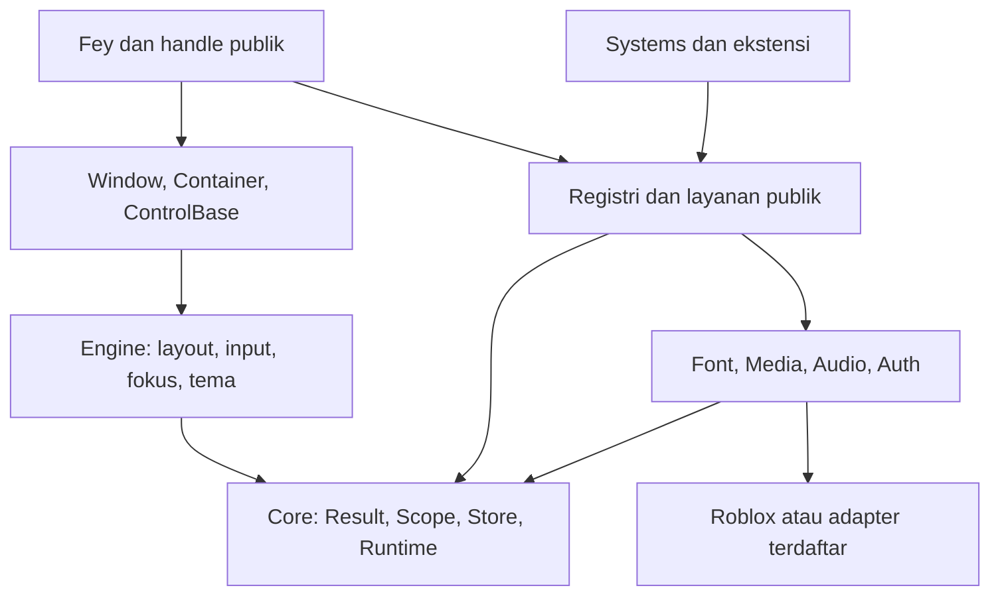
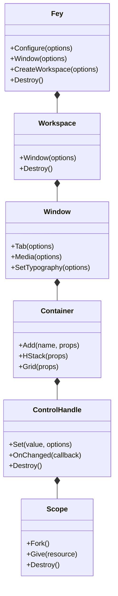

# Arsitektur dan kontrak publik

Target utama ialah Roblox Studio dan experience berizin. Client memakai `LocalScript` yang melakukan `require(ModuleScript)` dan memasang UI pada `PlayerGui`. Server menangani akses istimewa, HTTP yang dikonfigurasi, dan penyimpanan server. Studio plugin membutuhkan host dan parent yang berbeda sehingga menjadi profil tersendiri. Pemuatan dari URL hanya ditawarkan pada host sah yang telah membuktikan akses HTTP dan kemampuan kompilasi; `ServerScriptService.LoadStringEnabled` berlaku di server. Mode remote bukan jalur UI standar Studio.

Root → workspace (implisit untuk `Fey:Window`) → window → tab/section/container → node. Resource didaftarkan pada scope saat dibuat. Mount persiapan → validasi → commit node → `OnMounted`. Saat destroy, tandai subtree terminal dan batalkan pekerjaan dulu, lepas input/overlay/focus dan kembalikan fokus hanya ke target hidup, tutup anak lalu instance milik scope dari urutan terbalik, kirim `OnDestroyed` sekali dan putuskan signal. Hasil async membawa nomor generasi; panggilan engine yang sudah yield bisa selesai kemudian tetapi hasil usangnya dibuang. `Destroy()` idempoten. `MoveTo` memakai reparent transaksi: tolak root lain, siklus, dan target scope mati; batalkan pointer capture, pertahankan ID, flag dan nilai, lalu hitung ulang layout/style/fokus. Source root punya ID dan host-owned registry untuk reuse/replace/separate. Kebijakan lintas evaluasi bundle membutuhkan host registry eksplisit; tanpa itu jaminan hanya per instance/modul, dengan diagnostik yang menjelaskan batasnya.

## Tipe dan hasil

| Tipe kontrak | Bentuk dan aturan |
|---|---|
| `Result<T>` | Union diskriminan `{ok:true,value:T}` atau `{ok:false,error: FeyError}`. |
| `FeyError` | `{code, publicMessage, context, recoverable, retryable?, suggestedFix?, developerDetail?}`. context/detail sudah disanitasi. |
| `Connection` | `Disconnect()` idempoten, `Connected` read-only. Listener ditangkap sesuai urutan registrasi dan lepas sewaktu scope mati. |
| `Task<T>` | `Cancel(reason?)`, `Await(timeoutSeconds?) -> Result<T>`, `OnSettled(callback) -> Connection`. Tepat satu hasil terminal. |
| `SourceTag` | `"user" \| "programmatic" \| "restore" \| "remote"`. Event menyertakan `{previous, source, revision, controlId}`. |
| `SetOptions` | `{source?, silent?, animate?, persist?, validate?}`. `silent` menahan callback publik. Validasi invariants selalu berlaku, `validate=false` melewati validator kustom yang diizinkan. |
| `NodeProps` | `{id?,name?,description?,tooltip?,icon?,flag?,default?,size?,variant?,style?,theme?,slots?,visibleIf?,enabledIf?,lockedIf?,requires?,premiumOnly?,dependsOn?,tags?}`. Inferensi `id` hanya untuk penggunaan nonpersisten. |
| `Capability` | `{id, state: "available" \| "unavailable" \| "unknown", reason?, checkedAt?}`. Bukti per host dan aset. |
| `JSONValue` | Nilai finite dan serializable, warna sebagai string kanonik atau objek skema, tanpa function, instance, metatable, siklus. |

Constructor sinkron (`Window`, `CreateWorkspace`, `Tab`, `Section`, named component, `Add`, `Auth`) mengembalikan handle langsung agar chaining sesuai §26. Konfigurasi fatal melempar pesan berkode di luar callback; kegagalan recoverable via `TryAdd`, pemeriksa skema, metode mutasi atau task. Callback publik selalu dilindungi boundary dan error dibukukan. Registry case-sensitive PascalCase; opsi alias huruf kecil dapat dihasilkan secara konsisten. Metode domain seperti `Media:Resolve` mengembalikan verdict bahkan ketika perlu fallback. Getter snapshot hanya mengembalikan salinan/read-only; akses handle mati mengembalikan `COMPONENT_DESTROYED` pada operasi bernilai, event destroy tetap satu kali.

| Pemilik | Permukaan publik yang dibekukan sebagai desain Fase 0 |
|---|---|
| `Fey` | `Configure`, `Window`, `Auth`, `SetTheme`, `RegisterTheme`, `RegisterFont`, `RegisterMediaAdapter`, `RegisterSound`, `Use`, `Notify`, `CreateWorkspace`, `GetDiagnostics`, `GetCapabilities`, `RegisterComponent`, `Devtools`, `Destroy`. Registrasi dan mutasi memberi Result. |
| Workspace/Window | `Window`, `Tab`, `Media`, `Show/Hide`, `SetTheme`, `SetTypography`, `SetNavigation`, `Minimize/Restore`, `Dock/Undock`, `Destroy`; pilihan yang relevan per handle. Workspace memiliki fokus dan docking. |
| Tab/Section/Container | `SubTab`, `Section`, `HStack`, `VStack`, `Grid`, `Add(name, props)`, `TryAdd`, `Media`, `SetTypography`, registry konstruktor yang kompatibel dengan parent. |
| Component handle | `Set/Get/Reset`, `Enable/Disable/SetDisabled`, `Show/Hide/SetVisible`, `Lock/Unlock`, `SetProps/SetStyle/SetThemeOverride`, `SetFont/SetIcon/SetTooltip/SetDescription`, `SetOrder/MoveTo/MoveUp/MoveDown`, `Focus/Blur/Refresh/Serialize/Destroy`, `OnChanged/OnMounted/OnDestroyed/OnInteract/OnFocus/OnBlur/OnValidate/OnError` sesuai model di katalog. |
| Registri | `Fey.Theme:Derive(base, overrides)`; `Fey.Fonts:Preload/Resolve/GetStatus/Register/List/Compare/UnloadUnused`; `Fey.Media:Resolve`; `Fey.Audio:Play/Stop/FadeTo/SetScene/SetBusVolume/RegisterSound/RegisterSoundPack/RegisterPlaylist/BindSFX/Mute/Unmute/Destroy`. |
| Ekstensi | `Fey.Nexus:Use/Remove/List/Get/HasCapability/RequestPermission`; `Fey.Hub:RegisterExperience`; `Fey:Use` meneruskan ke Nexus; callback plugin menerima scope yang dapat dicabut dan registry APIs yang disetujui. |

`SetProps` menormalisasi dan memvalidasi seluruh patch sebelum commit; subscriber melihat snapshot lengkap. `Set` read-only bisa mengganti konten sesuai kontrak komponennya. Aksi stateless/scope struktural mengembalikan `UNSUPPORTED_OPERATION` dari `Set/Get/Reset`. `Focus` gagal eksplisit pada kontrol tanpa focus target; `Serialize` membuang kredensial dan data transien. `Lock` melarang perubahan dari interaksi pengguna. `disabled` menonaktifkan interaksi; mutation programmatik tetap tunduk schema, izin dan entitlement. Restore flag dalam transaksi (defaults → persisted → developer → user secara bawaan); computed disortir topologis dan siklus ditolak. Flag bertabrakan kecuali memiliki binding bersama eksplisit dengan tipe, namespace dan strategi merge yang sama. Auto-dependency via snapshot pembaca read-only, atau `dependsOn` eksplisit. Re-evaluasi event-driven dalam batch.

## Jendela, kustomisasi, dan layout

Jenis standard/compact/fullscreen/split/dashboard/modal/overlay/floating/widget/sheet/sidebar/tray/auth/workspace adalah preset komposisi. Workspace menentukan z-order, top modal dan keaktifan audio. Navigation kiri/kanan/top/bottom/hidden, rail/drawer/segmented/dock/nested/breadcrumb/command mode memakai satu node model dan tab ID yang sama. Overlay root menangani popover di luar clipping window, tab order, Back/Escape, focus restore dan dimming per scope. Layout memakai constraints/min/max, flex columns 1–4 dengan breakpoint collapse, list/grid serta viewport clamp; efek dan frame dekoratif tidak ikut hit testing. Auto-dock/resize dapat dibatalkan dan menghormati safe bounds. Judul, header/footer, avatar, watermark, topbar/control order, dimensi, drag, docking, persisten dan art slot mengikuti window options. Mini-mode/PiP punya return action dan optional mini-player. Slots `Leading/Main/Trailing/Footer/Overlay/Background` dan slot bernama seperti `topbar.leading` menerima child/renderer kustom yang tidak menelan input dari aksi inti.

Precedence state/variant → component → container → window → framework → named theme → safety defaults. Patch runtime menulis level yang dituju. Accessibility layer menerapkan min target, contrast dan motion pada final resolved tokens kecuali opt-out eksplisit dengan diagnostik. Status visual punya affordance selain warna. Token diff invalidasi berdasarkan dependency map; batching dengan satu viewport subscription, gesture capture per pointer, dan cache terukur per scope. UI model independen dari instance GUI sehingga reflow mempertahankan state, fokus dan nilai aktif.

## Distribusi dan batas layanan

Target pohon `src/core, engine, ui, systems, fonts, media, auth, extensions`, manifests `assets/`, `examples/`, `tests/`, `tooling/`, `docs/` dan `dist/Feybrume.lua`. Bundler fase 14: resolve path internal dari entry, cek cycle/missing module sebelum build, topological sort dengan tie-break path byte-order, pertahankan semantics require cache dan diagnostic path, normalisasi UTF-8/LF, pin toolchain, versi dan SHA-256. Uji byte-for-byte dua clean builds. Output Studio/ModuleScript dan bundle runtime satu file berasal dari modul yang sama; fixture memeriksa parity. Opsional transpile type annotation dengan parser, setelah bukti host dan parity. Asset/media/font packs dan layanan auth versioned eksternal, keyless tanpa dependensi. Dokumen instalasi akan menunjukkan require dan URL rilis immutable dengan checksum, fail-safe dan rollback. Publikasi kode/asset memerlukan lisensi proyek pilihan pemilik dan bukti lisensi aset. Fase 0 mencatat manifest desain, belum menghasilkan bundle.

`SaveManager`/ThemeManager/FontManager/MediaManager/AuthSessionStore punya namespace terpisah. Penyimpanan memori sebagai baseline; file hanya adapter eksplisit dengan atomic replace bila tersedia, backup/migration dan quarantine corrupt. Penyimpanan Roblox lintas sesi memerlukan server authority, DataStore dan rate limits. Config export bersih dari auth credential. JSON remote schema-versioned dibatasi ukuran, domain, timeout, max panjang dan umur cache. Check update opt-in. Nexus menjalankan plugin developer tepercaya dan terpin dengan izin bagi API framework, bukan sandbox keamanan Luau; tidak memuat script dari manifest PlaceId atau label command. Hub memilih page dari IDs dan hak yang lolos validasi server. Tidak ada fingerprint perangkat default; telemetry opt-in dan diagnostics redacted.

## English handoff

The first supported entry point is a Roblox client ModuleScript mounted under PlayerGui. Platform-sensitive work is delegated to capability adapters. Scope ownership, cancellation generations, transactional props and stable component IDs are shared contracts across phases. A privileged action must revalidate entitlements at the server. The build will produce a deterministic versioned bundle plus independently versioned asset packs. This document defines the API baseline for design review.
