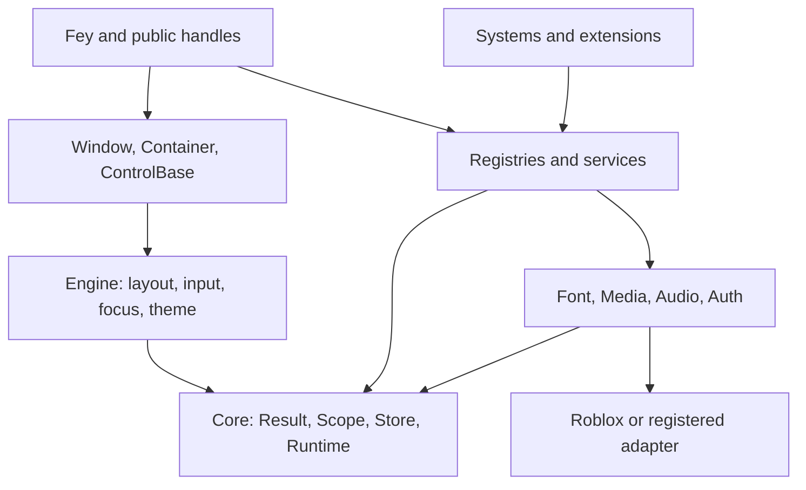
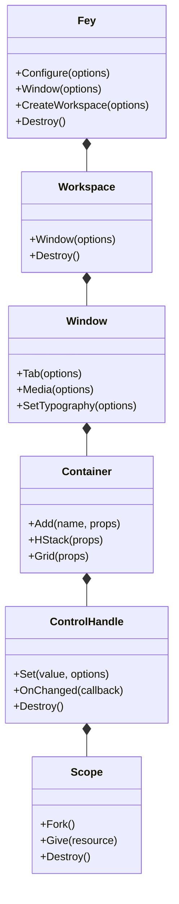

# Architecture and public contracts

Roblox Studio and authorized experiences are the primary targets. A client LocalScript requires the ModuleScript and mounts UI in PlayerGui. The server owns privileged operations, configured HTTP, and storage. Studio plugins use a separate host and parent. URL loading requires a permitted host with confirmed HTTP and compilation capability. Roblox's LoadStringEnabled is a server setting. [Runtime setup](core.md)

Ownership runs from root to workspace, window, tab or section, then component. Register each resource at creation. Mount prepares and validates a node before committing and emitting OnMounted. Destroy marks the subtree terminal, cancels pending work, releases input and overlays, restores focus to a live target, then closes owned instances in reverse order and emits OnDestroyed once. Generation checks discard asynchronous results that arrive late. MoveTo rejects cross-root moves, cycles, and disposed destinations. It releases pointer capture, preserves the ID and flag, and recomputes layout, style, and focus. Reuse or replacement across separate evaluations requires a host-owned registry.

## Types and results

| Contract | Shape and behavior |
|---|---|
| `Result<T>` | Discriminated union `{ok:true,value:T}` or `{ok:false,error: FeyError}`. |
| `FeyError` | `{code, publicMessage, context, recoverable, retryable?, suggestedFix?, developerDetail?}`. Context and details are sanitized. |
| `Connection` | `Disconnect()` is idempotent and `Connected` is read-only. Listeners dispatch in registration order and release with their scope. |
| `Task<T>` | `Cancel(reason?)`, `Await(timeoutSeconds?) -> Result<T>`, `OnSettled(callback) -> Connection`. Settles once. |
| `SourceTag` | `"user" \| "programmatic" \| "restore" \| "remote"`. The event includes `{previous, source, revision, controlId}`. |
| `SetOptions` | `{source?, silent?, animate?, persist?, validate?}`. `silent` suppresses public callbacks. Required schema checks always apply. `validate=false` skips eligible custom validators. |
| `NodeProps` | `{id?,name?,description?,tooltip?,icon?,flag?,default?,size?,variant?,style?,theme?,slots?,visibleIf?,enabledIf?,lockedIf?,requires?,premiumOnly?,dependsOn?,tags?}`. Infer an ID only for nonpersisted use. |
| `Capability` | `{id, state: "available" \| "unavailable" \| "unknown", reason?, checkedAt?}`. Evidence is scoped to the host or asset. |
| `JSONValue` | Finite, serializable values and canonical color strings or schema objects. Functions, instances, metatables and cycles are excluded. |

Constructors such as Window, CreateWorkspace, Tab, Section, Add, and Auth return handles for chaining. Fatal configuration raises a coded error. TryAdd, validators, mutations, and tasks report recoverable failures as results. Protect public callbacks and record sanitized errors. Registry names use consistent PascalCase. Media:Resolve supplies a verdict when a fallback is necessary. Snapshots are read-only, and methods on disposed components return COMPONENT_DESTROYED where a result is expected.

| Owner | Planned public API |
|---|---|
| `Fey` | `Configure`, `Window`, `Auth`, `SetTheme`, `RegisterTheme`, `RegisterFont`, `RegisterMediaAdapter`, `RegisterSound`, `Use`, `Notify`, `CreateWorkspace`, `GetDiagnostics`, `GetCapabilities`, `RegisterComponent`, `Devtools`, `Destroy`. Registration and mutation return a Result. |
| Workspace/Window | `Window`, `Tab`, `Media`, `Show/Hide`, `SetTheme`, `SetTypography`, `SetNavigation`, `Minimize/Restore`, `Dock/Undock`, `Destroy`; Each handle exposes relevant operations. Workspace owns focus and docking. |
| Tab/Section/Container | `SubTab`, `Section`, `HStack`, `VStack`, `Grid`, `Add(name, props)`, `TryAdd`, `Media`, `SetTypography`, Registry constructors must support the parent. |
| Component handle | `Set/Get/Reset`, `Enable/Disable/SetDisabled`, `Show/Hide/SetVisible`, `Lock/Unlock`, `SetProps/SetStyle/SetThemeOverride`, `SetFont/SetIcon/SetTooltip/SetDescription`, `SetOrder/MoveTo/MoveUp/MoveDown`, `Focus/Blur/Refresh/Serialize/Destroy`, `OnChanged/OnMounted/OnDestroyed/OnInteract/OnFocus/OnBlur/OnValidate/OnError` See the catalog for which operations each handle supports. |
| Registri | `Fey.Theme:Derive(base, overrides)`; `Fey.Fonts:Preload/Resolve/GetStatus/Register/List/Compare/UnloadUnused`; `Fey.Media:Resolve`; `Fey.Audio:Play/Stop/FadeTo/SetScene/SetBusVolume/RegisterSound/RegisterSoundPack/RegisterPlaylist/BindSFX/Mute/Unmute/Destroy`. |
| Ekstensi | `Fey.Nexus:Use/Remove/List/Get/HasCapability/RequestPermission`; `Fey.Hub:RegisterExperience`; `Fey:Use` delegates to Nexus. Plugins receive a revocable scope and approved registry APIs. |

SetProps validates and commits the entire patch atomically. A read-only control may update visible content through Set if its contract allows it. Stateless actions return UNSUPPORTED_OPERATION for Set, Get or Reset. Focus reports an error when no target exists. Serialize excludes credentials and transient state. Lock prevents user changes. Disabled state blocks interaction. Programmatic changes still follow schema and permissions. Default restoration order is defaults, persisted values, developer values, then user changes. The store sorts computed keys by dependency and rejects cycles. Flags may share a key only with a matching schema, namespace and merge policy. Dependencies come from explicit keys or read tracking on a read-only snapshot.

## Windows, layout, and customization

Window compositions include standard, compact, fullscreen, split, dashboard, modal, overlay, floating, widget, sheet, sidebar, tray, auth, and workspace. A workspace owns window stacking, the active modal and audio focus. Navigation can move between rail, drawer, tabs, dock and breadcrumb modes while preserving the tab ID. The overlay root owns popovers, traversal, Escape or Back, focus restoration and dimming. Layout uses size constraints, one to four columns, breakpoint collapse and viewport clamping. Decorative frames do not receive input. Windows configure title, headers and footers, avatars, watermarks, dimensions, docking and persistence. Mini mode can provide a return action and media control. Leading, Main, Trailing, Footer, Overlay, and Background slots keep primary actions accessible.

Style precedence runs from safety defaults and named theme through framework, window, container, component, then state overrides. Accessibility applies minimum target size, contrast, and motion to the resolved style. State also has an affordance beyond color. Token diffs target dependent nodes. A root owns viewport observation and captures each active pointer separately. Reflow retains stable IDs, values and focus. [Implemented style resolver](design-system.md)

## Distribution and service boundaries

The source tree covers core, engine, UI, systems, fonts, media, auth, and extensions. The final bundler resolves internal imports, rejects cycles or missing modules, sorts paths deterministically, preserves require caching and diagnostics, and pins the toolchain and SHA-256. Studio and the single-file release share sources and parity fixtures. Repeated clean builds must match byte for byte. Font and media packs and hosted auth are versioned separately. The keyless path has no service dependency. Releases will document pinned URLs, checksums and rollback.

SaveManager, ThemeManager, FontManager, MediaManager, and AuthSessionStore use separate namespaces. Memory is the baseline. An explicit file adapter may provide atomic replacement, backup, migration and corrupt-file quarantine. Roblox cross-session storage uses server authority and rate limits. Config exports exclude auth credentials. Remote versioned JSON has bounded size, allowed domains, timeouts, length and cache lifetime. Update checks are opt-in. Nexus loads trusted, pinned developer plugins with scoped framework capabilities. A scope limits available APIs but cannot sandbox arbitrary Luau. The hub uses known place IDs and server-validated entitlements. Telemetry is opt-in and diagnostics are redacted.
