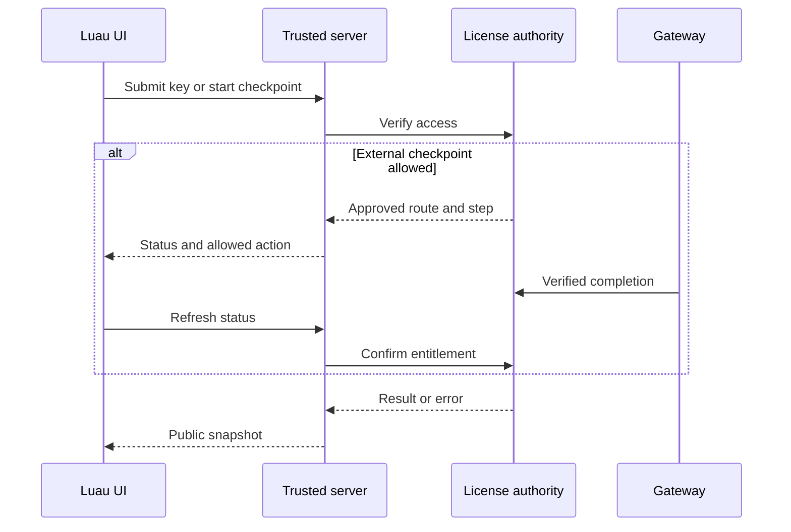

# Authentication, licensing, and gateways

## Platform policy

Published experiences must follow Roblox policy for off-platform links, QR codes, advertising and monetization. Use keyless access or server-verified roles where appropriate. Evaluate official passes, subscriptions, or rewarded video for monetization when eligible. Gateway selection and external handoffs require a verified host where policy allows them. Vendor documentation alone does not establish permission for an in-experience flow. [Roblox Community Standards](https://about.roblox.com/community-standards) · [Advertising Standards](https://en.help.roblox.com/hc/en-us/articles/13722260778260-Advertising-Standards) · [Social Links](https://create.roblox.com/docs/production/promotion/social-media-links) · [Rewarded Video](https://create.roblox.com/docs/production/promotion/rewarded-video-ads)

## Modes and trust boundary

| Mode | Authority | Behavior |
|---|---|---|
| Keyless | Public route | Open the UI without a key, domain or HTTP dependency. Privileged actions still follow server policy. |
| Local | Local validator or list | UI gating for a demo. Server authorization is independent. |
| Provider | Authorized backend and vendor | Validate keys, results and timeouts. Sensitive entitlements default to no offline grace. |
| Adgate | Provider-managed or trusted backend | Grant access after verified completion. An external link may hand off on an allowed host but still requires verification. |
| Hybrid | One entitlement authority | Prefer verified premium, time-limited and whitelist routes in that order, then a configured public route. Timeout never upgrades access. |

Represent idle, loading, validated, invalid, expired, banned, device mismatch, rate limit, network outage, waiting and retry states. Show step count, reward, cooldown and time remaining only when the authority supplies them. Feedback supports accessible focus and back navigation, portrait layouts and optional media with consent. Credentials remain masked until deliberately revealed. End the request scope on provider changes and logout.

Providers implement Init, GetCapabilities, Validate, Refresh, GetEntitlements, GetKeyLink, Logout, GetStatus and Destroy. Gateways implement Init, GetCapabilities, Begin, GetProgress, Cancel and Destroy. Operations expose timed and cancellable tasks. The result carries ok, code, userMessage, retryable, and optional expiry, tier, entitlement, device, checkpoint and session fields. The server supplies and enforces expiry. Bind completion to nonce, timestamp, step, session and subject. Make receipts idempotent and verify signed callbacks or query the vendor server. Reject replay. Store credentials only on trusted infrastructure and keep them out of logs, configs and public snapshots. In Roblox, use the authenticated server-side UserId and recheck privileged actions on the server. Failover must preserve the same verified authority.

Provider-managed routing intersects supported networks, project settings and host policy. Expose fallback selection, cooldowns and rotation only when supported. The first-party route design covers `POST /v1/auth/validate`, `POST /v1/auth/refresh`, `POST /v1/auth/logout`, `POST /v1/checkpoints` and `GET /v1/checkpoints/{id}`. Authenticate against server sessions and allowlist upstream hosts. Webhook contracts require vendor evidence. Feybrume has no deployed auth endpoint.

## Provider registry

| Adapter | Evidence | Integration status |
|---|---|---|
| Luarmor | External key validation and Rewards document key status, expiry and checkpoints. [External key check](https://docs.luarmor.net/docs-for-3rd-parties/3rd-party-external-key-check-api) · [Rewards](https://docs.luarmor.net/ad-system-rewards) | Planned. Verify API access, server signatures, result schema, timeouts and expiry. |
| Panda Auth | Documentation covers per-step providers, locks, choices and backup routing. [Overview](https://ads.pandauth.com/docs/for-developers/overview) · [API](https://ads.pandauth.com/docs/api-reference/overview) · [Monetization](https://ads.pandauth.com/docs/for-developers/monetization) | Planned. Verify dashboard settings and reject rewards granted after a failed check. |
| Vampauth | Documentation covers keys, optional device binding and checkpoints. [Key system](https://vampauth.com/roblox-key-system) · [integration guide](https://vampauth.gitbook.io/vampauth-docs/getting-started/choose-an-integration) | Planned. Validate with server-side key checks, versioned fixtures and expiry. |
| KeyVortex | The product advertises licensing and UI customization. [Product](https://keyvortex.oybofficial.com/) | API unverified. Requires a versioned endpoint, schema and authorized server credentials. |
| Pelinda / Pelican | Panda describes Pelinda as an SDK with Init and GetKeyLink. Pelican's identity remains unverified. [Panda V3 External](https://ads.pandauth.com/docs/for-developers/v3-external) | Planned as Panda compatibility, sharing Panda's authority. The Pelican alias is blocked. |
| SVAL | Provider identity and contract remain unknown. | API unverified. |
| KeyAuth | The license login and dashboard references cover app licenses. [License login v1.3](https://docs.keyauth.cc/api/getting-started/license/license-login) · [license dashboard](https://docs.keyauth.cc/dashboard/app/licenses) | Planned. Keep seller credentials out of app sessions and test expiry and revocation. Gateway support remains unverified. |
| Auth.GG | The current versioned first-party API remains unverified. | API unverified. |
| OpenAuth | The product site describes an API. Host and schema compatibility remain unverified. [OpenAuth.gg](https://openauth.gg/) | API unverified. Confirm the project and contract version before integration. |
| LuaProtect-style | The references document server authentication and device binding reset. [API Authentication](https://docs.luaprotect.dev/api-authentication) · [License keys](https://docs.luaprotect.dev/guides/license-keys) | API unverified for public entitlement validation. The design keeps the provider separate from delivery. |
| CustomEndpoint | See the proposed first-party routes above. | Planned. Use an HTTPS allowlist, server secrets, a configured schema and integration fixtures. |

## Provider × gateway matrix

L is Luarmor, P Panda, V Vampauth, KV KeyVortex, PL Pelinda/Pelican, S SVAL, KA KeyAuth, AG Auth.GG, OA OpenAuth, LP LuaProtect, and C CustomEndpoint. D means documented provider-managed, S conflicting or pending, I inherited from the same verified Panda service, B backend-managed candidate, E external link only, and U unverified. Every pair needs sandbox or contract evidence before production use.

| Gateway | L | P | V | KV | PL | S | KA | AG | OA | LP | C | Notes |
|---|---|---|---|---|---|---|---|---|---|---|---|---|
| Work.ink | D | D | D | U | I | U | U | U | U | U | B | Provider-managed. A custom backend requires a verified completion contract. [Work.ink key flow](https://blog.work.ink/using-the-key-system-to-make-money-with-your-software/) |
| LootLabs | D | D | D | U | I | U | U | U | U | U | B | Provider-managed. Verify the postback contract and schema for custom backends. [Postback](https://help.lootlabs.gg/en/article/postback-api-1ndz3i2/) |
| Linkvertise | D | D | D | U | I | U | U | U | U | U | U | Provider-managed through documented Rewards and monetization support. |
| Platoboost | U | U | U | U | U | U | U | U | U | U | E | External key link. No verified provider pairing or completion contract. [Plato portal](https://auth.platoboost.app/) |
| AdMaven | U | D | U | U | I | U | U | U | U | U | B | Verify the completion callback independently from link creation. [Content locker API](https://publishers-help.ad-maven.com/en/article/admaven-content-locker-api-documentation-11q0a5r/) |
| Boostelar | U | S | U | U | S | U | U | U | U | U | U | Panda lists Revenue Mode and also marks the integration as Soon. Verify in an authorized sandbox. |
| Fly Inc / Rinku | U | S | U | U | S | U | U | U | U | U | U | Panda documentation lists it and marks it as Soon. Verify in an authorized sandbox. |
| Lockr.so | U | D | U | U | I | U | U | U | U | U | U | Provider-managed in Panda documentation. |
| Short-Jambo | U | D | U | U | I | U | U | U | U | U | U | Provider-managed in Panda documentation. |
| Cuty.io | U | D | U | U | I | U | U | U | U | U | U | Provider-managed in Panda documentation. |
| ShrinkEarn | U | D | U | U | I | U | U | U | U | U | U | Provider-managed in Panda documentation. |
| ShrtFly | U | D | U | U | I | U | U | U | U | U | U | Provider-managed in Panda documentation. |
| Rekonise | U | U | U | U | U | U | U | U | U | U | E | External link only. The published flow does not establish a receipt API. [Release links](https://rekonise.com/features/release-links) |
| MBoost | U | U | U | U | U | U | U | U | U | U | B | Status polling is documented. Verify subject binding and idempotency before granting access. [Key system guide](https://docs.mboost.me/keysystem/guide/) |
| Paster | U | U | U | U | U | U | U | U | U | U | U | Identity and API remain unverified. |
| BoostInk | U | U | U | U | U | U | U | U | U | U | U | Identity and API remain unverified. Treat it as a separate service. |
| CustomGateway | U | E | U | U | E | U | U | U | U | U | B | Panda Universal Link configures a shortener per step. Verify each pairing and require proof of completion for a custom backend. [Universal Link Panda](https://ads.pandauth.com/docs/for-developers/provider-universal-link) |

AUTH-01–15 cover keyless operation, local rejection, invalid input, rate limits and timeouts, expiry and offline revocation, device mismatch, replay and retries, forged redirects, verified multi-step completion, tenant failover, redaction, retention, cancellation races, native policy, and signed provider fixtures. All live provider and gateway tests remain pending.
