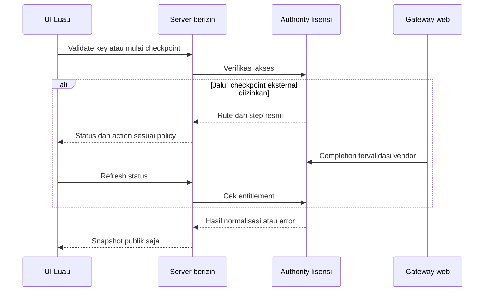

# Auth, licensing, dan ad gateways

## Kebijakan platform dan target penggunaan

Untuk experience Roblox, tombol/QR/teks Get Key tidak boleh mengarahkan pemain ke jaringan iklan atau halaman layanan pihak ketiga yang tidak diizinkan. Roblox membatasi cara berbagi URL eksternal, membatasi monetisasi off-platform untuk item/fitur on-platform, dan memiliki aturan terpisah untuk iklan. Gunakan keyless atau verifikasi role secara server untuk tool berizin. Untuk monetisasi dalam experience, evaluasi fitur Roblox seperti Passes, Subscriptions, dan Rewarded Video menurut eligibility serta ketentuannya. Mode adgate eksternal, UI pemilih jaringan, dan external YouTube handoff dipertahankan sebagai kontrak **host eksternal sah** yang secara eksplisit mengizinkan alur tersebut, serta memerlukan policy/age/privacy review. Native Roblox menampilkan fallback yang patuh dan tidak menyediakan URL atau QR yang dilarang. Bukti dukungan vendor tidak menentukan bahwa flow boleh digunakan dalam game. [Roblox Community Standards](https://about.roblox.com/community-standards) · [Advertising Standards](https://en.help.roblox.com/hc/en-us/articles/13722260778260-Advertising-Standards) · [Social Links](https://create.roblox.com/docs/production/promotion/social-media-links) · [Rewarded Video](https://create.roblox.com/docs/production/promotion/rewarded-video-ads)

## Alur dan trust boundary

| Mode | Authority | Pengalaman pengguna dan fallback |
|---|---|---|
| keyless (default) | Public route | Buka UI langsung, notice opsional, berjalan tanpa domain/key/HTTP. Hak istimewa server tetap mengikuti server policy. |
| local | Function/list di local runtime | UI gating untuk demo/tool pribadi. Client yang diubah bisa melewati UI. Tidak mengotorisasi aksi server. |
| provider | Roblox server/layanan backend berizin → vendor | Verifikasi format/timeouts dan hasil domain; masukkan key atau gunakan account hasil server. Offline grace default off untuk entitlement sensitif. |
| adgate | Provider-managed, backend-managed, atau externalLinkOnly | Provider/backend harus membuktikan completion; external link saja hanya handoff di host sah, tetap minta key yang lolos validasi. Fallback keyless memberi hak publik yang dikonfigurasi. |
| hybrid (route composition) | Satu entitlement authority | Rute free, whitelist, premium, ad-earned time atau Discord resmi. Precedence premium tervalidasi → time-limited tervalidasi → whitelist tervalidasi → public route bila ada. Tidak ada upgrade karena timeout. |

UI state idle, loading, validated, invalid, expired, banned, device mismatch, rate limited, network down, waiting checkpoint, retry, password reveal, subscription selection, premium available, offline limited. Step count, reward, cooldown dan waktu sisa hanya dari authority (bila unknown kosongkan). Session/requests punya scope dan generation, termasuk switch tab/provider/logout. Config UI mencakup centered, split hero, fullscreen hero, glass, stepper, dua panel, sheet, popup, animated gradient, slideshow, video poster, 3D atau wizard; tema, ukuran/slot/locale, field, note/legal/help/Get Key/progress/close/language/media/SFX. Reveal key hanya deliberate, mask default, redaksi semua log. Keyboard, focus/back, portrait dan native fallback mengikuti Mobile. Musik scene hanya jika consent dan referensi asset valid.

`Provider:Init/GetCapabilities/Validate/Refresh/GetEntitlements/GetKeyLink/Logout/GetStatus/Destroy` async dengan timeout/cancellation pada I/O. `Validate({key,device?,app}, context) -> Task<AuthResult>`. `AuthResult={ok,code,userMessage,developerMessage?,retryable,expiresAt?,tier?,entitlements?,devices?,checkpoint?,session?,extra?}`. Waktu UTC epoch seconds dari server, expiry ditegakkan server. `Gateway` kontrak Init/GetCapabilities/Begin/GetProgress/Cancel/Destroy; konfirmasi completion hanya via runtime server atau provider. Body schema allowlist, bounded retries dengan backoff/rate limit, host allowlist, tls, input caps, redaction dan server-stored secrets. Identity authoritative memakai Roblox UserId dari koneksi server bila di Roblox; external install ID adalah sinyal lemah opsional. Tidak memasukkan kredensial ke snapshot, config atau log. Simpan hanya apa yang dibutuhkan, logout revokes bila didukung. Backend bind nonce/timestamp/expiry/step/session/subject, atomic dedup idempotency, signed postback bila didokumentasikan atau verify via vendor server; challenge timeout/replay rejection, signature comparison yang aman dan replay store terpisah. Jangan menerima HMAC secret dari client. Kegagalan berantai di provider tetap fail closed, failover harus memakai authority mapping yang sama dan sudah diverifikasi. Roblox server harus verifikasi lagi setiap aksi privileged, UI state hanya presentasi.

Provider-managed mendahulukan key-link milik vendor. `preferredNetworks` membatasi pilihan tampilan melalui intersection provider capability × konfigurasi project × host policy; backup/multi-network per langkah, cooldown/TTL/region/rotasi hanya bila server/vendor mendukung, UI tidak dapat override lock. Backend-managed memakai storage checkpoint dan receipt verifikasi tadi. Kontrak first-party opsional direncanakan (rute milik proyek): `POST /v1/auth/validate`, `POST /v1/auth/refresh`, `POST /v1/auth/logout`, `POST /v1/checkpoints`, `GET /v1/checkpoints/{id}`; enum response/error bersama, identity dari session server. Endpoint webhook dirancang setelah vendor contract diperoleh. Client tidak memilih upstream host melalui remote JSON. Belum ada endpoint Feybrume yang terpasang.

## Provider registry (11)

| Adapter | Evidence saat riset | Integrasi / syarat live |
|---|---|---|
| Luarmor | [External key check](https://docs.luarmor.net/docs-for-3rd-parties/3rd-party-external-key-check-api), [Rewards](https://docs.luarmor.net/ad-system-rewards) mencatat status key/expiry dan flow checkpoint. | NOT_IMPLEMENTED. Test project, schema result, signature vendor di server, timeout, banned/expired dan hak API. |
| Panda Auth | [Overview](https://ads.pandauth.com/docs/for-developers/overview), [API](https://ads.pandauth.com/docs/api-reference/overview), [Monetization](https://ads.pandauth.com/docs/for-developers/monetization). Per-step, provider lock dan pilihan/backup terdokumentasi. | NOT_IMPLEMENTED. Cek plan dan dashboard nyata; reject reward dari mode vendor yang memperlakukan verifikasi gagal sebagai selesai. |
| Vampauth | [Key system](https://vampauth.com/roblox-key-system), [integration guide](https://vampauth.gitbook.io/vampauth-docs/getting-started/choose-an-integration). Key checks, HWID yang opsional dan checkpoint. | NOT_IMPLEMENTED. Pilih server key-check; review version/error/expiry dan fixtures, jangan pakai opaque loader. |
| KeyVortex | [Produk](https://keyvortex.oybofficial.com/) menyebut licensing dan UI customization. | BLOCKED_API_UNVERIFIED. Butuh endpoint versioned, schema dan server credentials yang sah. |
| Pelinda / Pelican | [Panda V3 External](https://ads.pandauth.com/docs/for-developers/v3-external) mendokumentasikan Pelinda sebagai SDK, termasuk Init/GetKeyLink. Identitas Pelican belum terbukti. | NOT_IMPLEMENTED untuk adapter kompatibilitas Panda, memakai capability Panda yang benar-benar tersedia; bukan authority alternatif. Pelican alias BLOCKED. |
| SVAL | Nama dari brief; kontrak dan identitas produsen belum ditemukan. | BLOCKED_API_UNVERIFIED. |
| KeyAuth | [License login v1.3](https://docs.keyauth.cc/api/getting-started/license/license-login) dan [license dashboard](https://docs.keyauth.cc/dashboard/app/licenses). | NOT_IMPLEMENTED. Pisahkan app session dari seller credentials; live test revoked/expiry. Belum ada bukti gateway langsung. |
| Auth.GG | Belum ditemukan dokumentasi pemilik yang cukup untuk kontrak versi aktif. | BLOCKED_API_UNVERIFIED. |
| OpenAuth | [OpenAuth.gg](https://openauth.gg/) menampilkan referensi API untuk produk tersebut. Belum konfirmasi platform dan schema yang berlaku untuk host target. | BLOCKED_API_UNVERIFIED. Cek identitas proyek dan contract version, jangan samakan dengan OAuth library lain. |
| LuaProtect-style | [API Authentication](https://docs.luaprotect.dev/api-authentication) dan [License keys](https://docs.luaprotect.dev/guides/license-keys) mendokumentasikan autentikasi server management dan reset device binding; license/gateway scope perlu bukti endpoint target. | BLOCKED_API_UNVERIFIED untuk validasi entitlement publik. Tidak memakai bundling/loader obfuscated sebagai mekanisme Feybrume. |
| CustomEndpoint | Kontrak first-party di atas. | NOT_IMPLEMENTED. HTTPS allowlist, server secrets, schema adapter yang dipilih operator, integration fixtures. |

## Matriks provider × jaringan (semua kombinasi belum lulus uji live)

Kolom L Luarmor, P Panda, V Vampauth, KV KeyVortex, PL Pelinda/Pelican, S SVAL, KA KeyAuth, AG Auth.GG, OA OpenAuth, LP LuaProtect, C CustomEndpoint. `D` didokumentasi untuk provider-managed; `S` sumber sendiri bertentangan atau Soon; `I` hanya diwarisi Pelinda jika service Panda yang sama dikonfirmasi (Pelican belum); `B` calon backend-managed dengan referensi langsung vendor, butuh proof completion; `E` hanya externalLinkOnly pada host yang mengizinkan; `U` pasangan belum terverifikasi, dinonaktifkan. Semua U perlu dokumentasi upstream dan uji sandbox; D dan I perlu fixture sah, plan, route/policy, credentials dan konfirmasi server. Bukan kolom dukungan dalam Roblox experience.

| Jaringan | L | P | V | KV | PL | S | KA | AG | OA | LP | C | Bukti / integrationLevel untuk desain |
|---|---|---|---|---|---|---|---|---|---|---|---|---|
| Work.ink | D | D | D | U | I | U | U | U | U | U | B | [Work.ink key flow](https://blog.work.ink/using-the-key-system-to-make-money-with-your-software/), providerManaged / customBackend setelah bukti. |
| LootLabs | D | D | D | U | I | U | U | U | U | U | B | [Postback](https://help.lootlabs.gg/en/article/postback-api-1ndz3i2/), providerManaged / customBackend; periksa bukti dan schema. |
| Linkvertise | D | D | D | U | I | U | U | U | U | U | U | Rewards dan provider monetization di atas; providerManaged. |
| Platoboost | U | U | U | U | U | U | U | U | U | U | E | [Portal Plato](https://auth.platoboost.app/); identitas layanan key-link terpisah, belum ada pasangan vendor atau completion contract terbukti. |
| AdMaven | U | D | U | U | I | U | U | U | U | U | B | [Content locker API](https://publishers-help.ad-maven.com/en/article/admaven-content-locker-api-documentation-11q0a5r/); cek callback terpisah dari link creation. |
| Boostelar | U | S | U | U | S | U | U | U | U | U | U | Panda Revenue Mode mencantumkan, sidebar menandai Soon. Gerbang disabled sampai dashboard/test resmi. |
| Fly Inc / Rinku | U | S | U | U | S | U | U | U | U | U | U | Keadaan dokumentasi Panda serupa Boostelar. |
| Lockr.so | U | D | U | U | I | U | U | U | U | U | U | Katalog dan subdoc Panda; providerManaged. |
| Short-Jambo | U | D | U | U | I | U | U | U | U | U | U | Katalog dan subdoc Panda; providerManaged. |
| Cuty.io | U | D | U | U | I | U | U | U | U | U | U | Katalog dan subdoc Panda; providerManaged. |
| ShrinkEarn | U | D | U | U | I | U | U | U | U | U | U | Katalog dan subdoc Panda; providerManaged. |
| ShrtFly | U | D | U | U | I | U | U | U | U | U | U | Katalog dan subdoc Panda; providerManaged. |
| Rekonise | U | U | U | U | U | U | U | U | U | U | E | [Release links](https://rekonise.com/features/release-links); externalLink. Klaim validasi internal tidak memberi Feybrume receipt API. |
| MBoost | U | U | U | U | U | U | U | U | U | U | B | [Key system guide](https://docs.mboost.me/keysystem/guide/) mendokumentasikan polling status. Backend perlu bukti binding subject/session dan idempotency sebelum dapat memberi entitlement. |
| Paster | U | U | U | U | U | U | U | U | U | U | U | Identitas dan API belum terverifikasi. |
| BoostInk | U | U | U | U | U | U | U | U | U | U | U | Jangan diasumsikan sama dengan Boostelar atau Work.ink. |
| CustomGateway | U | E | U | U | E | U | U | U | U | U | B | [Universal Link Panda](https://ads.pandauth.com/docs/for-developers/provider-universal-link) didokumentasikan sebagai URL shortener manual per step; completion assurance untuk pasangan arbitrer memerlukan bukti tersendiri. CustomBackend membutuhkan adapter yang bisa membuktikan receipt dan shared authority. |

Uji AUTH-01 keyless tanpa jaringan, 02 local hasil/gagal tanpa privilege; 03 malformed, 04 network/rate-limit/timeout, 05 expiry dan offline revocation, 06 device mismatch, 07 retry/replay/idempotency, 08 forged/completion redirect, 09 checkout 3 langkah authoritative di mana sah, 10 failover tenant mismatch, 11 redaksi/secret scan, 12 cookie/PII retention/erase, 13 cancellation/logout race, 14 pengujian native policy (termasuk tidak ada QR terlarang), 15 fixture positive/signed verification per pasangan yang diaktifkan. Seluruh uji runtime belum dilakukan. Kandidat provider dan gateway tidak dipromosikan ke produksi tanpa walkthrough sandbox dan bukti positif serta negatif.

## English handoff

Auth and monetization checkpoints use different registries. Keyless is the zero-dependency path. A click, URL redirect, or client state cannot prove completion. Roblox policy constrains links and monetization in published experiences. Provider/gateway evidence records vendor documentation and separate blockers. All live integration and device claims are pending.
